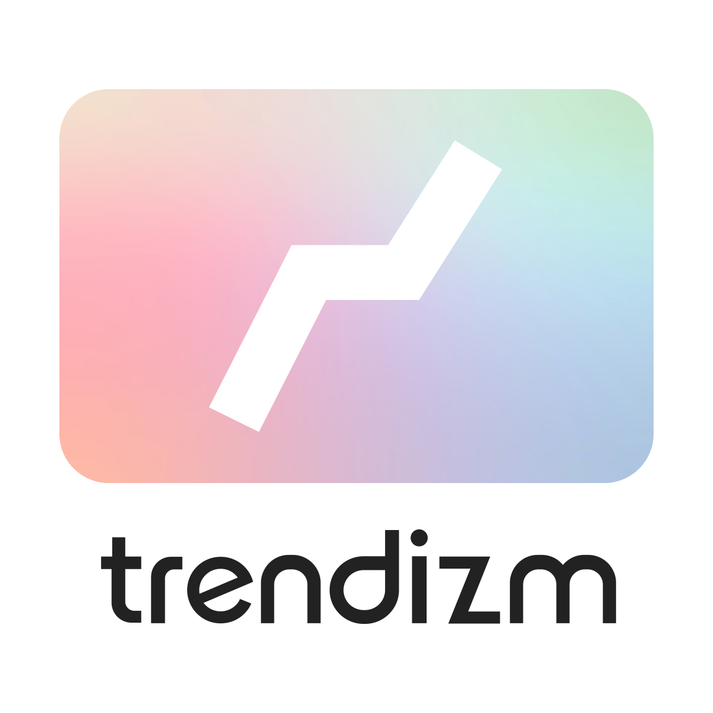
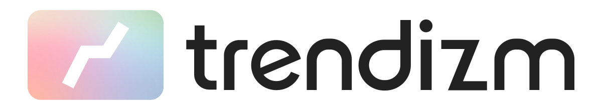

# trendizm

트렌드 검색기

- [소개](#소개)
- [개발 배경](#개발-배경)
- [핵심 기능](#핵심-기능)
- [사용 예시](#사용-예시)
- [팀원 및 역할](#팀원-및-역할)
- [기술 스택](#기술-스택)
- [직접 실행 방법 및 접속 방법](#직접-실행-방법-및-접속-방법)

## 소개

<p>
  
  &nbsp;&nbsp;
  
  &nbsp;&nbsp;
</p>
<p>
  
</p>

**trendizm**

남들은 다 아는데 내가 검색하면 나오지 않는 유행어나 단어,
유행인 건 알겠는데 그 출처가 어딘지 쉽고 정확하게 알 수 있도록 검색 및 공유 커뮤니티를 제공합니다.

## 개발 배경

현재 유행은 너무 빠릅니다. 이 유행이나 단어가 어떤 뜻인지 아는 것에 시간을 할애하기엔 현대 사회는 너무 바쁩니다.

저희와 같이 궁금증은 있는데 시간은 부족하고 찾아도 한계가 있는 사람들을 위해서 만들었습니다.

## 핵심 기능

> [!NOTE]
> 현재 개발이 진행 중인 프로젝트입니다. 아래 기능과 사용 예시는 완성된 서비스를 기준으로 적었으며, 아직 구현되지 않은 부분도 있습니다.

### 밈 검색

유튜브 동영상, SNS 피드, 인스타그램 릴스 같은 매체에서 본 단어를 검색합니다. 매체의 주소와 단어를 함께 입력하면, 그 단어를 잘 아는 사람들이 남긴 해석을 볼 수 있습니다.

- 같은 단어라도 출처마다 문서를 나누어, 그 매체에서 어떤 뜻으로 쓰였는지 보여 줍니다.
- 해석에 동의·비동의 투표를 하고 댓글을 나눌 수 있습니다.
- 신뢰도순과 최신순으로 해석을 정렬합니다.

### 플랫폼별 트렌드 순위

여러 매체를 합쳐 가공한 '시그널 실시간 검색어'나 zum의 'AI 이슈 트렌드'와 달리, 플랫폼마다 살아 있는 트렌드 순위를 그대로 보여 줍니다.

- YouTube, Instagram, Threads, X, TikTok 등 플랫폼과 카테고리를 나누어 순위를 제공합니다.
- 순위에 오른 키워드와 관련된 게시물로 바로 이동할 수 있습니다.

### 트렌드 아이템

패션, 뷰티, 리빙, 취미, 디지털, 재테크 분야의 제품과 관련 상품 정보를 나와 비슷한 사람들에게서 얻습니다. 개인정보에 설정한 연령과 성별이 기준이 됩니다.

예를 들어 안경을 쓰고 싶은데 안경을 잘 모른다면, 나와 같은 연령·성별에서 패션을 잘 아는 사람이 추천하거나 많은 사람이 애용하는 아이템을 확인할 수 있습니다.

- 궁금한 점을 질문으로 올리면 다른 사용자가 아이템을 추천하거나 댓글로 의견을 남깁니다.
- 추천 아이템은 블러로 가려져 있고, 건당 100원(100P)을 내면 열립니다.
- 아이템을 올린 사람은 다른 사람이 열 때마다 건당 100원(100P) 정도의 수익을 얻습니다.

### 호·불호 평점

영화·드라마 같은 미디어나 프랜차이즈 신제품이 좋은지 나쁜지 한눈에 확인하는 척도는 별점 하나뿐입니다. 하지만 별점은 평균값일 뿐 절대적인 기준이 되기 어렵고, 평가에는 저마다의 취향이 반영됩니다.

그래서 '좋다'를 선택한 사람과 '별로다'를 선택한 사람을 나누고, 두 그룹의 평점을 양쪽에 보여 줍니다.

- 연령, 성별, MBTI, BMI, 취미, 직업군 등 평가에 영향을 줄 수 있는 요소 중 각 그룹에서 가장 많이 해당하는 5개를 평점 위에 표시합니다.
- 어떤 사람들이 좋아하고 싫어했는지 확인하고, 나와 비슷한 쪽의 평점을 참고할 수 있습니다.

### 클러스터 설정 & 피드

기존 매체에서는 알고리즘에 이끌려 콘텐츠를 보는 일이 많았습니다. trendizm은 그 알고리즘을 '클러스터'라는 형태로 사용자에게 보여 주고, 직접 바꿀 수 있게 합니다.

- 클러스터는 자동으로 붙지만, 직접 설정해서 어떤 이슈가 있는지 확인할 수도 있습니다.
- 피드는 일방적으로 보여 주는 추천이 아니라, 내가 설정하고 편집하는 알고리즘이 됩니다.
- '숏폼'과 '롱폼' 두 탭으로 나누고, 각 탭에서 유튜브·인스타그램·틱톡 콘텐츠를 섞어 보여 줍니다.

## 사용 예시

### 1. 밈 단어를 찾는 사람

> "댓글마다 나오는 이 단어, 검색해도 안 나오는데 무슨 뜻이지?"

1. **밈 검색**에서 단어를 본 게시물의 주소와 단어를 입력합니다.
2. 그 출처의 문서에서 해석과 사용 예문을 확인합니다.
3. 신뢰도순으로 정렬해 많은 사람이 동의한 해석부터 읽습니다.
4. 도움이 된 해석에 동의 투표를 하고, 더 궁금한 점은 댓글로 묻습니다.

### 2. 밈 단어의 뜻을 올리는 사람

> "이 밈, 어디서 나온 말인지 내가 알지!"

1. 로그인한 뒤 **밈 검색**에서 출처 주소와 단어를 입력합니다.
2. 단어의 뜻과 유래, 사용 예문을 해석으로 등록합니다. 아직 문서가 없는 단어라면 새 문서가 만들어집니다.
3. 다른 사용자의 동의·비동의 투표와 댓글을 확인하며 의견을 나눕니다.

### 3. 트렌드 아이템에서 의견을 구하는 사람

> "안경을 처음 맞추는데, 내 또래는 어떤 걸 많이 쓸까?"

1. **트렌드 아이템**에서 '패션' → '안경·액세서리'를 고르고 **질문하기**를 누릅니다.
2. 제목과 원하는 스타일·가격대를 적어 질문을 올립니다.
3. 질문에 달린 댓글과 추천 아이템을 확인합니다.
4. 블러로 가려진 추천 아이템 중 마음에 드는 것을 100P로 열어 제품명, 판매처, 가격, 상품 링크를 봅니다.

### 4. 트렌드 아이템에서 질문에 의견을 다는 사람

> "안경이라면 내가 추천해 줄 수 있지."

1. **트렌드 아이템**에서 잘 아는 분야의 질문을 찾습니다.
2. 간단한 의견은 댓글로 남깁니다.
3. 추천할 제품이 있으면 **아이템 추천하기**를 눌러 이름, 판매처, 가격, 태그, 설명, 상품 링크를 등록합니다.
4. 다른 사용자가 추천 아이템을 열 때마다 100P가 쌓입니다.

### 5. 호불호 평점을 보는 사람

> "별점은 높은데, 내 취향에도 맞을까?"

1. **호·불호 평점**에서 미디어, 푸드, 음악, 도서·웹툰, 게임, 장소 중 카테고리를 고릅니다.
2. 궁금한 콘텐츠의 호·불호 비율과 각 그룹의 평점을 비교합니다.
3. 그룹별 공통 특성 5개를 보고 나와 더 비슷한 쪽을 확인합니다.
4. 그 그룹의 후기를 읽고 볼지, 살지, 먹을지 결정합니다.

### 6. 호불호 평점에 평을 다는 사람

> "나는 재미있게 봤는데, 다른 사람들은 어땠을까?"

1. 로그인한 뒤 **호·불호 평점**에서 평가할 콘텐츠를 엽니다.
2. '좋다'와 '별로다' 중 하나를 고르고 별점을 매깁니다.
3. 한줄 제목과 후기를 적어 등록합니다. 콘텐츠에 후기를 처음 쓰면 10P를 받습니다.
4. 내 평가가 선택한 그룹의 평점과 공통 특성에 반영되고, 다른 사용자의 공감을 받습니다.

## 팀원 및 역할

|  |  |  |  |
| --- | --- | --- | --- |
| 김진엽 | 백승주 | 윤주상 | 최송민 |
| [@kjy-ux](https://github.com/kjy-ux) | [@backsjj-bit](https://github.com/backsjj-bit) | [@JoostLean](https://github.com/JoostLean) | [@songmin04](https://github.com/songmin04) |
| 회원·인증(BFF), 공통 응답·예외 처리, 알림(SSE), CI, 서버 배포 | 밈 검색(문서, 의견, 투표, 댓글, 썸네일, AI 요약) | 백엔드 아키텍처·프론트엔드 골격 세팅, 트렌드 순위 수집·조회, 피드 및 클러스터, ArchUnit 규칙, 협업 문서 | 트렌드 아이템, 포인트, 호·불호 평점 |

## 기술 스택

| 구분 | 기술 |
| --- | --- |
| 백엔드 | Java 21, Spring Boot 4.1.2, Spring Web MVC, Spring Data JPA, Spring Security, JWT(jjwt 0.12.6) |
| 프론트엔드 | Next.js 16.4.6, React 19.3.0, TypeScript 5 |
| 데이터베이스 | PostgreSQL 17, Redis 7.4 |
| AI | Gemini API (밈 의견 요약) |
| 테스트·품질 | JUnit 5, ArchUnit 1.5.1, H2, ESLint 9 |
| 빌드 | Gradle, npm |
| 배포 | Docker Compose, GitHub Actions, GitHub Container Registry, nginx |

백엔드는 헥사고날 아키텍처(포트·어댑터)로 구성했습니다. 브라우저는 Next.js 서버만 호출하고 Next.js 서버가 백엔드에 요청을 전달하는 BFF 방식을 사용합니다.

## 직접 실행 방법 및 접속 방법

### 직접 실행 방법

Docker, JDK 21(`21.0.13.1+4` 이상), Node.js 22가 필요합니다.

#### 1. 설정 파일 준비 (최초 1회)

```bash
git clone https://github.com/likelion-backendschool-9th/trendizm.git
cd trendizm

cp .env.example .env
cp compose.override.example.yaml compose.override.yaml
cp backend/src/main/resources/application-example.yml backend/src/main/resources/application.yml
cp backend/src/main/resources/data.example.sql backend/src/main/resources/data.sql
```

`.env`를 열어 아래 값을 채웁니다.

| 항목 | 값 |
| --- | --- |
| `DB_PASSWORD` | 사용할 PostgreSQL 비밀번호 |
| `JWT_SECRET` | 32자 이상의 임의 문자열 |
| `GEMINI_API_KEY` (선택) | Google AI Studio에서 발급한 Gemini API 키. 비워 두면 AI 요약 기능만 꺼집니다 |

로컬의 5432 포트를 이미 쓰고 있다면 `DB_PORT`도 `5433` 등으로 바꿉니다.

#### 2. PostgreSQL, Redis 실행

프로젝트 루트에서 실행합니다.

```bash
# 최초 실행
docker compose up -d --build

# 이후 실행
docker compose up
```

`docker compose up`은 터미널을 계속 사용하므로 다음 단계는 새 터미널에서 진행합니다.

#### 3. 백엔드 실행

```bash
cd backend
./gradlew bootRun
```

Windows에서는 `gradlew.bat bootRun`을 실행합니다.

#### 4. 프론트엔드 실행

백엔드를 켜 둔 채 새 터미널을 열어 프로젝트 루트에서 실행합니다.

```bash
cd frontend
npm ci
npm run build
npm run start
```

이후에는 `npm run start`만 실행하고, 코드가 바뀌었을 때 `npm run build`를 다시 실행합니다.

PostgreSQL, Redis, 백엔드, 프론트엔드가 모두 켜져 있어야 서비스를 정상적으로 확인할 수 있습니다. 브라우저에서 <http://localhost:3000>으로 접속합니다.

로컬에서는 `data.sql`로 만든 계정을 사용합니다.

| 구분 | 이메일 | 비밀번호 |
| --- | --- | --- |
| 관리자 | `admin@trendizm.local` | `password123` |
| 일반 사용자 | `user@trendizm.local` | `password123` |

### 접속 방법

배포된 서비스는 <https://trendizm.newlecture.com>에서 이용할 수 있습니다. 아래 계정으로 로그인합니다.

| 구분 | 이메일 | 비밀번호 |
| --- | --- | --- |
| 관리자 | `admin@trendizm.net` | `12345678` |
| 일반 사용자 | `demo.hunter@trendizm.test` | `Demo1234!` |
| 일반 사용자 | `demo.socks@trendizm.test` | `Demo1234!` |
| 일반 사용자 | `demo.fashion@trendizm.test` | `Demo1234!` |
| 일반 사용자 | `demo.drama@trendizm.test` | `Demo1234!` |
| 일반 사용자 | `demo.foodie@trendizm.test` | `Demo1234!` |
